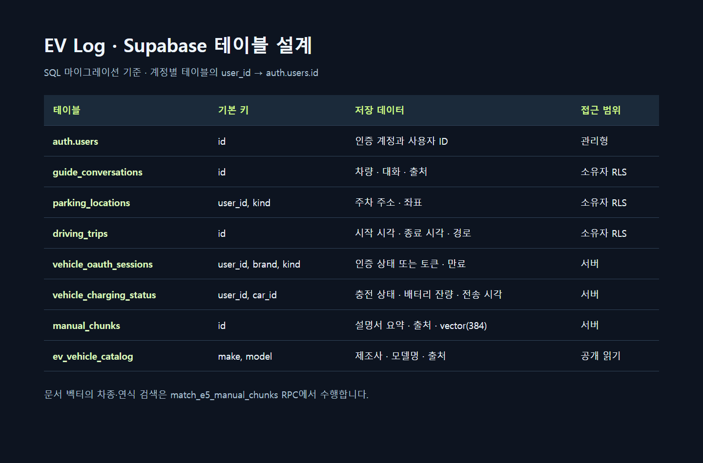

# Supabase 테이블 설계

설계 담당은 **성남주**입니다. 캡처는 실제 SQL 마이그레이션의 구조를 재구성한 화면입니다. 운영 레코드는 포함하지 않았습니다.

| 테이블 | 기본 키 | 주요 데이터와 접근 |
| --- | --- | --- |
| `auth.users` | `id` | Supabase Auth가 관리합니다. 계정별 테이블의 `user_id`가 참조합니다. |
| [guide_conversations](../supabase/migrations/202611250009_guide_conversations.sql) | `id` | 제목, 당시 차량, 메시지 배열, 갱신 시각. 본인만 관리합니다. |
| [manual_chunks](../supabase/migrations/202611250008_manual_e5_embeddings.sql) | `id` | 제조사·차종·연식, 설명서 요약, 출처와 384차원 임베딩. 서버가 검색합니다. |
| [ev_vehicle_catalog](../supabase/migrations/202611240003_vehicle_catalog.sql) | `make, model` | 차량 이름과 출처. 공개 읽기 범위입니다. |
| [parking_locations](../supabase/migrations/202611240004_parking_locations.sql) | `user_id, kind` | 최근 주차 주소·좌표·갱신 시각. 본인만 접근합니다. |
| [driving_trips](../supabase/migrations/202611240005_driving_trips.sql) | `id` | 시작·종료와 경로 좌표 배열. 본인이 저장한 운행 기록을 조회합니다. |
| [vehicle_oauth_sessions](../supabase/migrations/202611240006_vehicle_oauth_sessions.sql) | `user_id, brand, kind` | OAuth 상태 또는 토큰과 만료 시각. 서버만 접근합니다. |
| [vehicle_charging_status](../supabase/migrations/202611240007_vehicle_charging_status.sql) | `user_id, car_id` | 충전 여부·플러그·잔량·목표·전송 시각. 서버가 계정과 차량별 최신 값을 보관합니다. |

차계부와 사용자가 직접 등록한 카드 정보는 브라우저에 계정별로 저장됩니다. CODEF 샌드박스 응답은 화면에서만 확인합니다.
