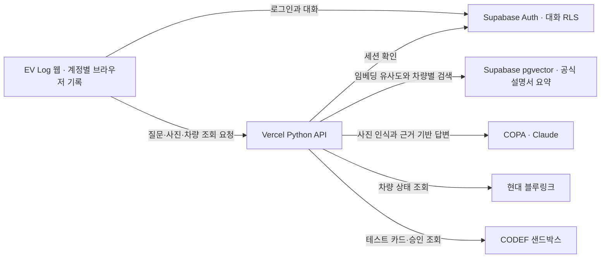

# EV Log 기능 및 비기능 요구사항

## 기능 요구사항

| ID | 요구사항 | 수용 기준 |
| --- | --- | --- |
| F01 | 이메일 가입·로그인과 차량 등록 | 로그인한 사용자가 제조사·차종·연식을 저장하고 경고등 화면에서 차량 표시를 확인할 수 있다. |
| F02 | 텍스트 및 계기판 사진 질문 | 사진만 보낼 수도 있다. 인식된 경고 표시를 답변과 함께 보여준다. |
| F03 | 차량 설명서 검색과 답변 | 등록 차종·연식에 대응하는 설명서 근거를 답변에 사용한다. 근거가 있으면 링크를 표시하고, 일반 안내는 별도 표기한다. |
| F04 | 대화 보관과 재개 | 본인 대화 목록을 열거나 삭제할 수 있고, 이어서 질문할 때 당시 차량과 최근 대화를 사용한다. |
| F05 | 충전 모니터링 | 화면을 보는 동안 승인된 현대 차량을 조회한다. 목표 전 충전 중단과 수신 지연에 관측값과 확인 순서를 표시한다. |
| F06 | 차계부 | 충전량과 정비 비고를 각 기록에 표시하고, 카드 CSV에서 승인·취소·중복을 처리한다. |
| F07 | 주차 위치와 주행 목록 | 마지막 저장 위치와 주소를 표시하고, 확인 가능한 주행 기록을 날짜별로 열 수 있다. |
| F08 | 카드사 연동 테스트 | CODEF 샌드박스의 가상 카드 목록과 마스킹된 승인내역 응답을 보여준다. |

## 비기능 요구사항

| ID | 요구사항 | 확인 방법 |
| --- | --- | --- |
| N01 | 개인 데이터 접근 제한 | 로그인 없이 앱 기능에 접근할 수 없고, Supabase 대화 테이블은 계정별 RLS를 적용한다. 브라우저 기록 저장 키도 계정별이다. |
| N02 | AI 투명성 | AI 답변 라벨, 설명서 출처, 사진에서 읽은 내용과 일반 안내를 화면에서 확인할 수 있다. |
| N03 | 개인정보 최소화 | 가입 화면에서 이름·차량 저장에 동의하며, 사진을 첨부할 때 전송 동의를 확인한다. 카드번호 전체·CVC는 입력 필드에 없고 첨부 사진 원본은 대화 DB에 남지 않는다. |
| N04 | 장애 대응 | 모델·검색 오류 시 제공 가능한 공식 근거를 표시한다. 차량 응답이 비거나 20초 안에 오지 않으면 이전 값의 시각과 미수신 상태를 보여준다. |
| N05 | 배포와 재현성 | Vercel HTTPS 주소, 로컬 실행법, 서버 변수 예시, DB 마이그레이션과 테스트 기록이 있다. |

## 시스템 아키텍처

사진 질문은 Claude에서 경고 표시를 읽은 뒤 질문과 결합한다. Python이 질문 임베딩을 계산하고 같은 제조사·차종·연식의 설명서 조각을 찾는다. 유사도 0.83 이상인 최대 3건을 답변 근거로 제공한다. 벡터 결과가 부족하면 공식 설명서 요약에서 키워드를 확인한다. 근거를 찾지 못한 답변에는 일반 안내 표시를 붙인다.

모니터링 판정은 수신값과 시각을 비교하는 규칙으로 처리한다. 화면이 열린 동안 확인할 수 있다. 실차 충전 중단, 제조사 API가 제공하지 않는 정보 및 카드 실거래 자동 조회는 검증 범위와 구분한다.
